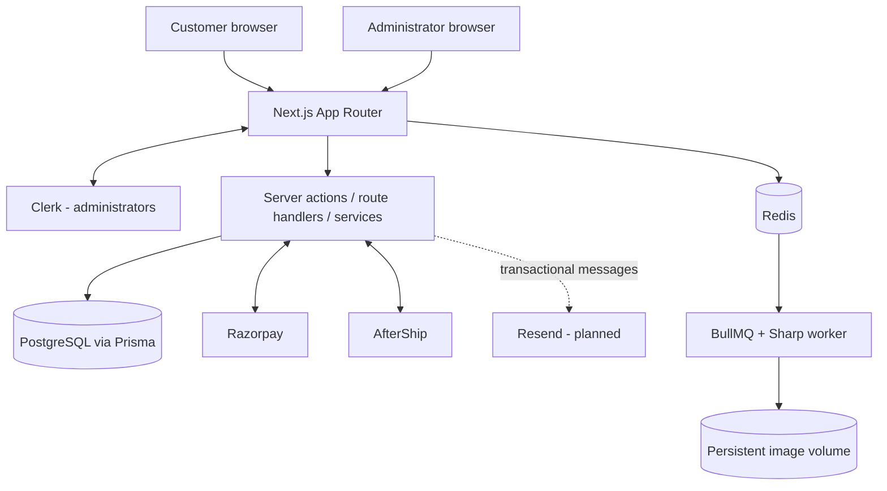

# Shoes House — Architecture

> This is the repository-level architecture summary. Guest checkout, private order links, and Resend are approved target changes; mark them implemented only after code and integration tests pass.

## System

## Identity boundaries

- Customers are guests. Customer-facing sign-in, signup, profile, account sessions, and OTP login are not part of the target storefront.
- Clerk remains for administrator authentication.
- Administrator authorization is server-side through the existing admin guards and `isAdminUser()` policy.
- Customer order access is intended to use a high-entropy private order token, not a Clerk identity, order ID alone, email-only lookup, or OTP.
- A private order token must be stored as a hash, validated server-side, and scoped to exactly one order.

## Checkout modes

- `CART`: validate guest cart contents server-side, create checkout session/order, and clear the browser cart only after successful order creation/fulfilment according to the chosen payment flow.
- `BUY_NOW`: build a single line from the selected product/variant; do not clear or mutate the existing cart.
- Razorpay browser success is not authoritative. Verify signature, captured state, amount, checkout session and idempotency server-side; retain webhook fulfilment.
- COD order creation must have explicit stock reservation/decrement semantics and must not oversell.

## Images

New product/banner uploads use staged local files, Redis/BullMQ, Sharp WebP conversion, and a persistent shared volume. Historical Cloudinary URLs remain a read-compatibility path only.

## Layer responsibilities

- UI: display and interaction; never trusted for authorization or price/stock.
- Actions/routes: validate inputs, enforce auth/token scope, translate HTTP/action results.
- Services: business logic, transactions, payment and email orchestration.
- Prisma: persistence, constraints, snapshots, idempotency and audit data.
- Workers: long-running image processing.

See `docs/` for implementation details and status.
